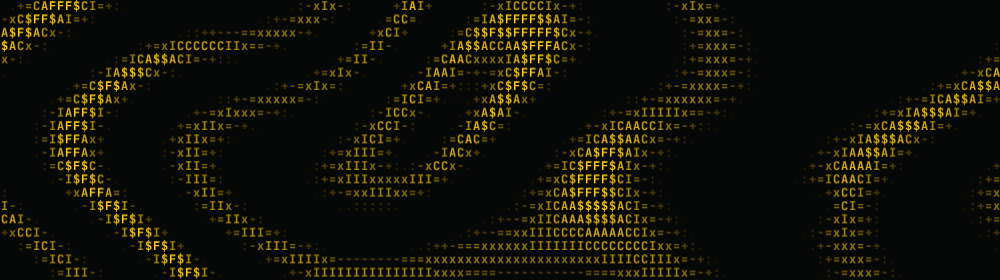

  <picture>
    <source srcset="assets/banner.webp" type="image/webp">
    
  </picture>

I'm Gustavo, a physician in Brazil, moving to Niedersachsen for neurology.

Most of what I write is software for a shift: a self-hosted tracker for my own symptoms, a reader that paces me through an epub, an engine that draws a whole screen with ASCII. When a tool I use every day gets in my way, I send a patch back to its repository.

## Contributing to

- **[react-pdf](https://github.com/diegomura/react-pdf)** : a checkbox wrote its value as a literal string, so readers saw a checked box as unchecked.
- **[OpenNext for AWS](https://github.com/opennextjs/opennextjs-aws)** : rewrites apply every matching rule, the way `next start` does.
- **[OpenCode](https://github.com/anomalyco/opencode)** : punctuation typed with its own key code, and a shell that finished no longer reported as backgrounded.
- **[Omarchy](https://github.com/omacom/omarchy)** : font names escaped before it rewrites configs, and an optional ASCII Paper wallpaper installer.

## Open-source works

- **[Datalyst](https://github.com/cYoren/datalyst)** : symptoms, sleep, mood, habits and money logged in a few seconds a day, then n-of-1 experiments with randomized schedules and power analysis. Self-hosted and MCP-ready.
- **[Licitações MCP](https://github.com/cYoren/licitacoes-mcp)** : read-only MCP server over PNCP and Compras.gov.br open data, with tools for finding a tender, reading its details and comparing prices.
- **[Speedready](https://github.com/cYoren/speedready)** : pacer and RSVP reader for epubs, with the translation sitting above every word you have not marked as learned. GTK4, plus a [web version](https://speedready.vercel.app).
- **[usbless-dualboot](https://github.com/cYoren/usbless-dualboot)** : installs Windows next to Linux using the internal SSD as the installer, shrinking LUKS, Btrfs or ext4 in place and putting the boot menu back.
- **[Puzzlestack](https://github.com/cYoren/Puzzlestack)** : one-minute logic, math, memory, spatial, attention and word puzzles dealt as a deck, in Flutter, on desktop, web and mobile.

## Research

- **[scfc](https://github.com/cYoren/SC-FC_coupling)** : structural and functional connectivity both shrink with distance, so a per-region coupling score can be large when function does not depend on structure at all. A synthetic benchmark with a known ground truth, then a preregistered two-dataset test.
- **[Awesome Hands-on Neuroscience](https://github.com/cYoren/awesome-hands-on-neuroscience)** : runnable notebooks, from spiking neurons to whole-brain imaging, written so someone without a neuroscience background can start.
- **[Dichotic listening trainer](https://github.com/cYoren/Dichotic-audio)** : a different track in each ear plus masking noise and difficulty presets, for training with CAPD and ASD. The audio stays in the browser.
- First author on a case report about endocrinopathies from pembrolizumab, in the *Brazilian Journal of Case Reports*: [doi:10.52600/2763-583X.bjcr.2025.5.1.bjcr15](https://doi.org/10.52600/2763-583X.bjcr.2025.5.1.bjcr15).

## After hours

- **[ASCII Paper](https://github.com/cYoren/asciipaper-engine)** : one GLSL `cell()` function rendered once per character, so a full screen of glyphs costs about as much as one quad. A Wayland live wallpaper in C, the same shaders in WebGL, plus video, GIFs and stills. [Run it in a browser](https://cyoren.github.io/asciipaper/).
- **[exoself](https://github.com/cYoren/exoself)** : a temperament for agents drawn from one 32-byte seed and expanded deterministically, so the same seed gives the same agent in any implementation. Python and Rust that agree, listed in the [Hermes plugin catalog](https://github.com/NousResearch/hermes-agent).
- **[dotfiles](https://github.com/cYoren/dotfiles)** : Omarchy 4 and Hyprland on a Dell G15, a glassy Quickshell bar, compositor plugins built from source, and the ASCII Paper engine as the wallpaper layer.
- **Advanced Dual N-Back** (closed): working memory training scored the way the studies score it, d-prime at fine N steps, personal baselines and programs. On the App Store and Google Play.
- **Sightread** (closed): sight reading trained as a reflex, with the microphone as the only input.

## Boring closed source work

The day job, in private repos.

- **MedHub / MedicinaHub**: practice software for Brazilian clinics, with agenda, confirmations, prontuário, documents, telemedicine, access per profile and a recorded consent trail, and licence guides for doctors moving their degree to another country. [medhub.one](https://medhub.one) · [medicinahub.com.br](https://medicinahub.com.br)
- **OnCall.med / Plantão.med**: calculators, interaction checks and prescriptions ready to paste, with every drug line pointing at a source, on iOS, Android, the web and a Chrome side panel.

  <a href="https://github.com/cYoren">GitHub</a> ·
  <a href="https://linkedin.com/in/gustavo-marcelino-443532109">LinkedIn</a> ·
  <a href="https://orcid.org/0009-0000-8283-1737">ORCID</a> ·
  <a href="mailto:gustavo.cesar.marcelino4@gmail.com">email</a>

The banner is a recorded loop of the engine, made by <a href="tools/record-banner.mjs"><code>tools/record-banner.mjs</code></a>.
